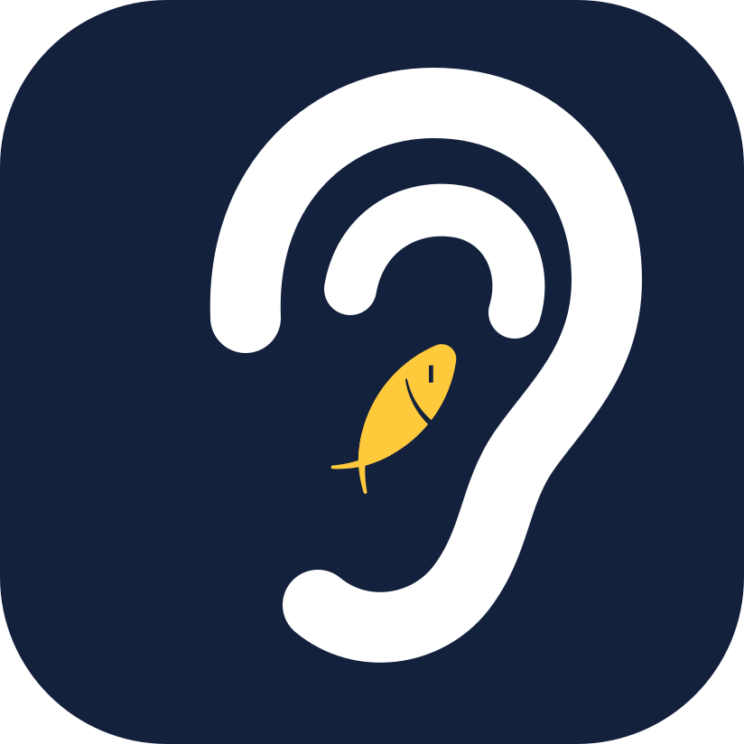
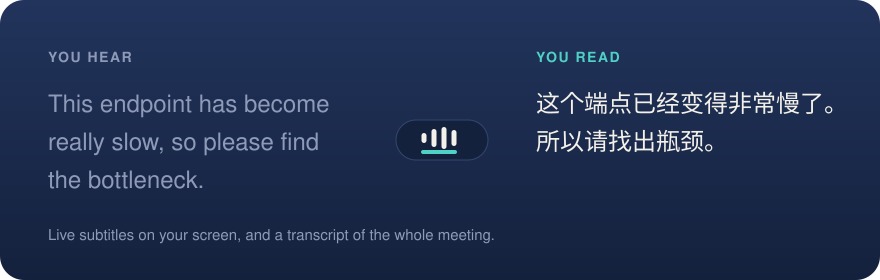
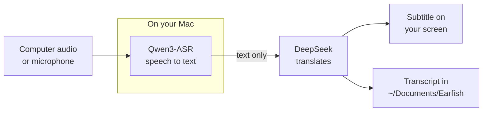

<p align="center">
  
</p>

<h1 align="center">Earfish</h1>

<p align="center">
  <strong>A fish in your ear for English meetings.</strong><br>
  Live Chinese subtitles for any English on your Mac, and a transcript of the whole meeting.
</p>

<p align="center">
  
  
  
</p>

<p align="center">
  
</p>

## How it works



- **Works with anything you can hear.** Videos, online meetings, or a talk in the room.
- **Audio stays on your Mac.** Speech recognition runs locally and audio is never saved. The recognized English goes to DeepSeek, so do not use Earfish for meetings that must stay private.
- **Nothing is lost.** If translation fails or takes over 5 seconds, you get the English.
- **Subtitles your way.** English above Chinese or Chinese alone, with separate font sizes, width, background, height on screen and how many sentences to show.
- **The meeting is written down.** Each session is a Markdown file with the time, the English and the Chinese for every sentence, saved as it happens.

## Performance

Measured on an M5 with 16 GB. Delays use synthesized speech, so the end of each sentence is known exactly. Recognition load and memory use 3 minutes of read-aloud clips from one speaker.

| After a sentence ends | English shown | Full Chinese | Recognition load | GPU memory |
|---|---|---|---|---|
| Median, 202 to 335 words a minute | 1.0 to 1.4 s | 1.8 to 2.4 s | 24% of real time | 1.13 GB |

Real speech runs a little slower than synthesized speech, and both samples are small. See [docs/design.md](docs/design.md) for the details.

## Quick start

You need an Apple Silicon Mac on macOS 14.2 or later, Python 3.12, the Xcode Command Line Tools and a DeepSeek API key.

```bash
python3.12 -m venv .venv
.venv/bin/pip install -e ".[dev]"
cp .env.example .env   # then add your DeepSeek key
macos/build.sh
open /Applications/Earfish.app
```

This builds a small native launcher and installs `Earfish.app`, which you can then open from Spotlight. To start it at login, add it under System Settings > General > Login Items. If the checkout is in Documents, allow that access when asked. A setup window shows what is left to turn on.

The first launch downloads the speech model. When the small Earfish window says Ready, choose Computer Audio or Microphone and press Start. Press Subtitle to change how the subtitles look. macOS asks for access the first time you use each source. Errors go to `~/Library/Logs/Earfish.log`.

## Good to know

- The app runs Python from this checkout, so code changes only need a restart. Moving the checkout or changing anything in `macos/` may mean granting the permissions again.
- The same controls are in the menu bar, but a crowded bar can hide them behind the notch.
- After you use the microphone, macOS shows its recording indicator until Earfish quits.
- Computer Audio only works from the app, because macOS ties that access to it.

## Translate a recording

```bash
.venv/bin/earfish clip.wav
```

This plays the file through the whole pipeline in real time and writes the transcript to `transcripts/`. Input must be 16 kHz mono WAV.

## Benchmarks

```bash
.venv/bin/python evals/bench_stream.py path/to/samples   # folder of en-*.wav clips
.venv/bin/python evals/bench_latency.py                  # calls the DeepSeek API
```

## License

[MIT](LICENSE)
